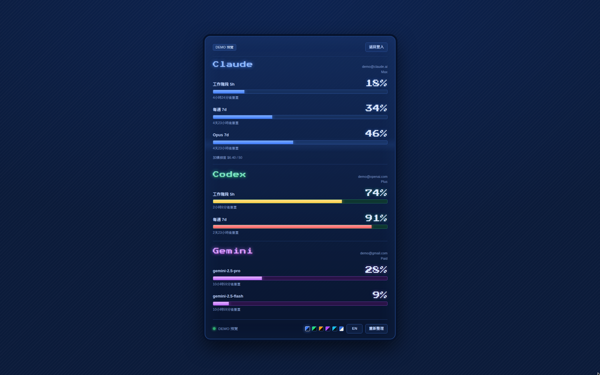

# AI Usage Web

[](https://github.com/richardrhg/ai-usage-web/actions/workflows/ci.yml)
[](LICENSE)



本機版的「Claude + Codex 用量儀表板」。在自己的電腦上跑，分別去問 Anthropic 和 OpenAI
目前的用量，把 5 小時 / 每週的額度畫成復古像素風網頁。

- 只用 Python 標準函式庫，**不需要 `pip install` 任何東西**
- 憑證自動偵測，通常什麼都不用設
- 六組配色可以隨時切換，選過的記在瀏覽器裡

## 需求

- Python 3.8+
- 想看 Claude 用量 → 裝好 [Claude Code](https://claude.com/claude-code) 並跑過一次 `claude` 登入
- 想看 Codex 用量 → 裝好 Codex CLI 並跑過一次 `codex` 登入

不想裝 CLI，或只裝了桌面版 App 導致抓不到憑證，可以改用長期 token，見
[拿一組長期 token](#拿一組長期-token)。

## 用法

```bash
python claude_usage_web.py                  # 兩邊都抓，開 http://127.0.0.1:8787
python claude_usage_web.py --demo           # 用假資料看畫面，不打任何 API
python claude_usage_web.py --only claude    # 只顯示 Claude
python claude_usage_web.py --only codex     # 只顯示 Codex
python claude_usage_web.py --port 9000 --interval 60
python claude_usage_web.py --theme amber    # 指定預設配色
```

| 參數 | 預設 | 說明 |
| --- | --- | --- |
| `--host` | `127.0.0.1` | 預設只綁本機。想給同網段其他裝置看再改 `0.0.0.0` |
| `--port` | `8787` | 網頁埠號 |
| `--interval` | `120` | 輪詢秒數 |
| `--only` | `both` | `both` / `claude` / `codex` |
| `--theme` | `midnight` | 開啟時的預設配色（瀏覽器記過的選擇優先） |
| `--demo` | — | 用假資料，不打 API |
| `--claude-token` / `--codex-token` | — | 手動指定 token，蓋過自動偵測 |

## 給內網其他電腦看

預設綁 `127.0.0.1`，只有本機連得到。要讓同網段的手機、筆電也能開，三個步驟。

**1. 綁到所有介面**

```bash
python claude_usage_web.py --host 0.0.0.0
```

**2. 查自己的區網 IP**

```bash
ipconfig
```

找「無線區域網路」或「乙太網路」底下的 IPv4 位址，通常長得像 `192.168.x.x`。
`172.x` 開頭那些多半是 WSL / Hyper-V / Docker 的虛擬網卡，不是你要的。

macOS / Linux 用 `ifconfig` 或 `ip addr`。

**3. 開防火牆**

Windows 要用**系統管理員身分**的 PowerShell 跑一次（只需要跑一次）：

```powershell
New-NetFirewallRule -DisplayName "AI Usage Web" -Direction Inbound -Protocol TCP -LocalPort 8787 -RemoteAddress 192.168.0.0/16 -Action Allow
```

`-RemoteAddress` 把來源限制在私有網段，網際網路上的其他人連不進來。想收得更緊就改成你實際的
網段，例如 `192.168.10.0/24`。

macOS 通常第一次啟動時會跳「是否允許接受連入連線」，按允許即可。Linux 若有 `ufw`：
`sudo ufw allow from 192.168.0.0/16 to any port 8787`。

**接著其他裝置開 `http://你的IP:8787` 就看得到了。**

### 幾個要知道的事

- **沒有任何驗證機制。** 同網段任何人打得到那個網址就看得到你的用量。好消息是網頁和 API 都只吐
  百分比和重置時間，token 不會出現在回應裡。
- **IP 可能會變。** DHCP 配的位址在路由器重開或租約到期後可能換號。長期用就去路由器設固定 IP，
  或試試 `http://電腦名稱:8787`。
- **Windows 的網路類別。** 如果你的網路被歸類成「公用網路」，防火牆封鎖會比較嚴。上面那條規則沒
  指定 `-Profile`，三種類別都會套用，所以照樣有效。
- **這東西上不了公網。** 它讀的是「執行它的那台機器」的本機憑證，部署到雲端等於把你的 token 放上
  去，而且所有訪客看到的都是你一個人的數字。人在外面想看就用 Tailscale 之類的方式把網路打通，
  不要把它掛到公開位址。

## 配色

網頁右下角六顆色票可以直接點，或按 <kbd>T</kbd> 循環切換：

`midnight` · `phosphor` · `amber` · `synthwave` · `ice` · `paper`

要加新主題：在 `PAGE` 的 CSS 補一段 `[data-theme="xxx"]`、`PAGE` 的 JS `THEMES` 陣列補一行，
再把 id 加進 `THEME_IDS`。

## 語言

中英文切換，右下角 `中文` / `EN` 按鈕，或按 <kbd>L</kbd>。第一次開啟時看瀏覽器語言決定，
之後記在瀏覽器裡。

翻譯全部在前端：伺服器只送穩定的 key（視窗的 `kind`/`win`、錯誤的 `code`），句子由 `PAGE`
的 JS `I18N` 組出來。所以切語言不用重打 API，也不會有伺服器語系跟瀏覽器對不上的狀況。
遇到沒收錄的錯誤 `code` 會直接顯示伺服器給的原句，不會變成空白。

要加第三種語言：在 `I18N` 補一組，鍵補齊就好，其他地方都不用動。

中文沒有像素字體（`Press Start 2P` 只有拉丁字母）。字型 fallback 是逐字發生的，兩種字型的
em 框比例差很多，同一行裡混排就會高低不一。所以做法是**以元素為單位換字型**：會出現中文的
元素（`.label`、`.reset`、`.psrc`、狀態列、按鈕）整個改用 `--zh-font`，元素內就只有一套度量；
純英數的 `.pname`（Claude / Codex）和 `.pct`（32%）維持像素字。

按鈕高度寫死 28px 並用 flex 置中，框就不會因為裡面是像素字還是中文而變高變矮。

## 憑證

兩邊都是自動偵測，照下面的順序找：

**Claude**

1. `CLAUDE_CODE_OAUTH_TOKEN` 環境變數
2. `~/.claude/.credentials.json`
3. macOS Keychain（`Claude Code-credentials`）

**Codex**

1. `CODEX_ACCESS_TOKEN` 環境變數
2. `~/.codex/auth.json`

Token 每次輪詢都會重讀，CLI 換發之後會自動跟上。程式本身不會把任何憑證寫進檔案或送去別的地方，
只拿來呼叫官方端點。

### Token 過期

兩邊的 access token 都有效期（Claude 大約幾小時到一天）。這支程式**只讀不換發** —— 換發是 CLI
在用的時候才會做的事。所以如果隔一陣子沒開過 CLI，token 過期後對應那一欄就會變成錯誤。

解法是跑一下 CLI 讓它換發：

```bash
claude          # 或 codex
```

換發完不用重開儀表板，下一次輪詢就會自己跟上。

用 `--claude-token` / `--codex-token` 手動指定的話沒有這個自動跟上的機制 —— 那組字串是寫死的，
過期就得自己換。長期跑建議讓它走自動偵測。

### 拿一組長期 token

如果你不想每天為了換發而開一次 CLI，可以改用長期 token。Claude Code 內建這個指令
（需要 Claude 訂閱）：

```bash
claude setup-token
```

走完瀏覽器授權後會印出一組 `sk-ant-oat01-` 開頭的字串。設成環境變數就好：

```powershell
setx CLAUDE_CODE_OAUTH_TOKEN "sk-ant-oat01-..."
```

macOS / Linux 是寫進 `~/.zshrc` 或 `~/.bashrc`：

```bash
export CLAUDE_CODE_OAUTH_TOKEN="sk-ant-oat01-..."
```

Windows 的 `setx` 只對**之後新開的**終端機生效，設完要重開一個視窗。環境變數是第一順位，會蓋過
`.credentials.json`，所以之後 CLI 的憑證再怎麼過期都不影響儀表板。

這組 token 效期長很多，但**一樣不會自動換發**，到期那天要再跑一次 `setup-token`。

> 用 Console 申請的 API key（`sk-ant-api03-` 開頭）**不能**用在這裡。程式送的是
> `Authorization: Bearer` 搭 `anthropic-beta: oauth-2025-04-20`，那是 OAuth token 的用法；
> API key 走的是 `x-api-key`，會被擋掉。

### 找不到 `claude` 指令（Windows）

如果 `claude` 不在 PATH 上，先確認你是怎麼裝的：

- **npm 安裝** —— `npm install -g @anthropic-ai/claude-code`，指令會放在
  `%APPDATA%\npm\`，通常已經在 PATH 上。
- **只裝了桌面版 App** —— 桌面版自帶一份 Claude Code，但不會加進 PATH。如果又是從
  Microsoft Store 裝的，檔案系統還會被 MSIX 虛擬化：套件內部看到的 `%APPDATA%\Claude\...`
  在一般終端機根本不存在，路徑打了會說找不到。實體路徑在這裡：

  ```
  %LOCALAPPDATA%\Packages\Claude_pzs8sxrjxfjjc\LocalCache\Roaming\Claude\claude-code\<版本>\claude.exe
  ```

  同樣的虛擬化也會讓桌面版寫的登入憑證躲在 `LocalCache` 底下，這支程式讀不到 ——
  所以只裝桌面版的話，自動偵測那條路是不通的，要嘛另外用 npm 裝一份 CLI，要嘛就走上面的
  長期 token。

## 說明

- Claude 那邊是送一個 `max_tokens: 1` 的極小請求，讀回應 header 裡的
  `anthropic-ratelimit-unified-*-utilization` 來取得用量。
- Codex 那邊打的是 Codex CLI 自己在用的 `https://chatgpt.com/backend-api/wham/usage`，
  OpenAI 沒有正式公開文件，**有可能會變**。

## 測試

測試不會讀取本機憑證，也不會呼叫任何外部 API：

```bash
python -m unittest discover -s tests -v
```

## License

[MIT](LICENSE)
